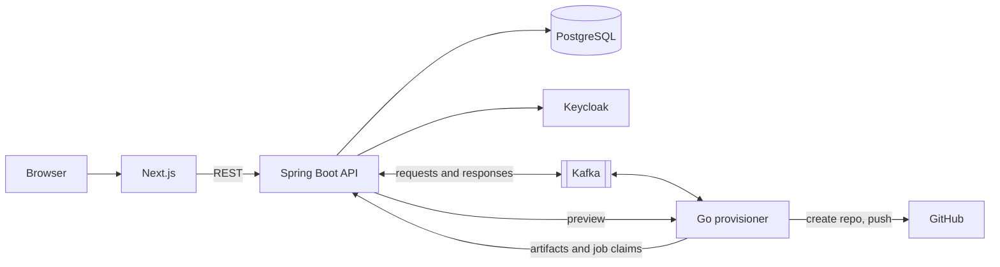

# DevForge

**An internal developer platform that turns a few choices into a ready-to-run GitHub repository.**

Pick a stack, choose a database, broker and extras, preview every generated file, and DevForge pushes a private repository with working code, CI and a Dockerfile. It can also generate a multi-service application in one repository, with a shared `compose.yaml`.


## Highlights

- **Composable templates:** 13 stacks, with feature selection (database, messaging, extras) on the Spring Boot templates.
- **Exact preview:** browse every file before creating the repository, rendered by the same code that does the real push.
- **Multi-service applications:** several services in one repository, with shared infrastructure and one database per service.
- **Reliable provisioning:** a transactional outbox, idempotent workers and rate-limit retries, so crashes and duplicate messages do not lose jobs or create duplicate repositories.
- **Built for concurrency:** partitioned Kafka consumers, per-tenant limits, and in-memory Git with no temporary files.
- **Multi-tenant and secure:** workspaces with roles, Keycloak with Google and GitHub login, `httpOnly` cookie sessions, and GitHub App integration.
- **Tested output:** CI builds generated projects and boots a four-service application with Docker Compose.

## Architecture



The Spring API owns business rules and data. The Go provisioner does the rendering and all Git work, asynchronously through Kafka.

**The [Architecture Guide](docs/ARCHITECTURE.md) covers the full design:** the request lifecycle, failure handling, the template engine, security, the patterns used and their trade-offs, and known limitations.

## Run it locally

### Prerequisites

- Docker with Docker Compose
- Node.js 22
- A [GitHub App](https://docs.github.com/en/apps/creating-github-apps), which DevForge uses to create repositories

Go and Java are only needed to run tests outside Docker. Those use Go 1.26 and Java 25.

### 1. Create a GitHub App

In GitHub, go to **Settings → Developer settings → GitHub Apps → New GitHub App**, then:

| Setting | Value |
|---|---|
| Callback URL | `http://localhost:8080/api/v1/github/callback` |
| Webhook URL | Your [smee.io](https://smee.io) channel, or disable webhooks for a first run |
| Repository permissions | **Administration:** read and write, **Contents:** read and write |

Generate a private key and save it as `backend/github-app.private-key.pem`. The `*.pem` pattern is ignored by Git. To keep a different filename, set `GITHUB_APP_KEY_FILE` in `backend/.env`.

### 2. Configure the backend

```bash
cp backend/.env.example backend/.env
```

On PowerShell, use `Copy-Item backend\.env.example backend\.env`.

Fill in `backend/.env`:

| Variables | What to set |
|---|---|
| `POSTGRES_*` | Any database name, user and password |
| `KEYCLOAK_*` | Admin credentials, client secret and database settings |
| `DEVFORGE_ADMIN_*` | The administrator account you will log in with |
| `GITHUB_APP_*` | Values from your GitHub App |
| `GITHUB_APP_PRIVATE_KEY_PATH` | Leave empty if `compose.yaml` supplies it; only needed outside Docker |
| `GITHUB_WEBHOOK_SECRET` | The webhook secret from your GitHub App |
| `INTERNAL_API_TOKEN` | **Required.** Any long random value, shared by the API and provisioner |
| `GITHUB_TOKEN_ENCRYPTION_KEY` | **Required for GitHub user tokens.** Base64 of 16, 24 or 32 random bytes |

Generate the two secrets with:

```bash
openssl rand -hex 32
openssl rand -base64 32
```

### 3. Start everything

From the repository root, with `make` available:

```bash
make run
```

Or step by step:

```bash
cd backend
docker compose up --build -d

cd ../frontend
cp .env.local.example .env.local
npm install
npm run dev
```

If you use `make run`, create `frontend/.env.local` first.

### 4. First-time setup

1. Open <http://localhost:3000> and log in with your `DEVFORGE_ADMIN_*` account.
2. Click the **template sync** button in the navbar. Templates are not loaded automatically, and this stores each one in the database.
3. Open your workspace settings and connect GitHub.
4. Create a service, or an application with several services.

| Service | URL |
|---|---|
| Frontend | <http://localhost:3000> |
| API docs (Swagger, `dev` and `test` profiles) | <http://localhost:8080/api/v1/swagger-ui/index.html> |
| Keycloak admin | <http://localhost:8180> |
| Provisioner health | <http://localhost:8081/health> |

To receive GitHub webhooks locally, set `SMEE_URL` in `backend/.env` and run:

```bash
cd backend
docker compose --profile webhooks up -d
```

To stop the stack, run `docker compose down` from `backend/`.

### Troubleshooting

| Symptom | Fix |
|---|---|
| Template not found, or "no stored artifact" | Run template sync as an administrator |
| Provisioner exits on startup | Set `INTERNAL_API_TOKEN` in `backend/.env` |
| "Connect a GitHub account" | Link a GitHub installation in workspace settings |
| Sync says to bump `version` | The template changed: raise `version` in its `template.yaml` |

## Tests

```bash
# API, fast tests
cd backend && ./mvnw -Dtest='!DevForgeApplicationTests' test

# API, everything (needs Docker for Testcontainers)
cd backend && ./mvnw test

# Provisioner
cd backend/provisioner && go test ./... && golangci-lint run --config ../.golangci.yml

# Frontend
cd frontend && npm run lint && npm run typecheck && npm test
```

GitHub Actions runs checks for the stack that changed, builds generated templates across feature combinations, and boots a sample multi-service application.

## Try the generator without the app

Generate a project or a whole application locally, with no GitHub or database:

```bash
cd backend/provisioner

go run ./cmd/template-gen -templates-root ../templates -template spring_Boot_Maven \
  -output /tmp/out -feature database=postgresql -feature extras=flyway

go run ./cmd/template-gen -templates-root ../templates \
  -spec testdata/application.json -output /tmp/app
```

## Project structure

```text
backend/
  src/            Spring Boot API
  provisioner/    Go worker and template engine
  templates/      Template catalog
  keycloak/       Realm configuration
frontend/         Next.js application
docs/             Architecture guide
.github/          CI workflows
```

## Contributing

Git hooks format code on commit and run tests on push:

```bash
go install github.com/evilmartians/lefthook@latest
lefthook install
```

See [CONTRIBUTING.md](CONTRIBUTING.md) for how to add templates and features.
