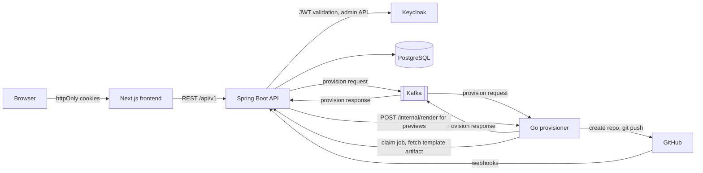
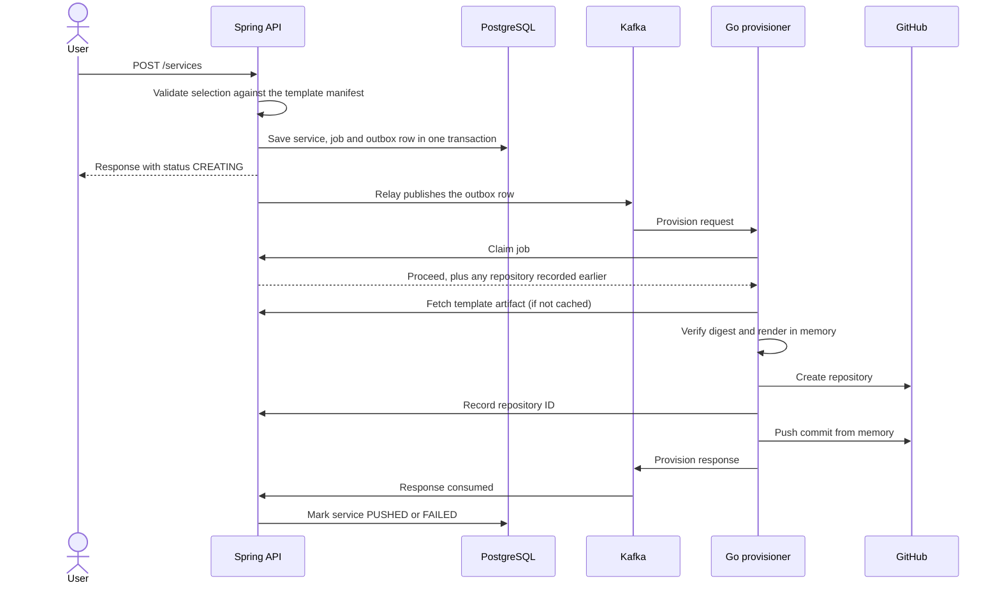

# DevForge Architecture Guide

This guide explains how DevForge works, why it is built this way, and what each design costs. For setup, see the [README](../README.md).

## Contents

1. [What DevForge does](#1-what-devforge-does)
2. [System overview](#2-system-overview)
3. [Life of a request](#3-life-of-a-request)
4. [Components](#4-components)
5. [Template engine](#5-template-engine)
6. [Multi-service applications](#6-multi-service-applications)
7. [Preview](#7-preview)
8. [Security](#8-security)
9. [Performance and concurrency](#9-performance-and-concurrency)
10. [Design patterns and why they are used](#10-design-patterns-and-why-they-are-used)
11. [Testing strategy](#11-testing-strategy)
12. [Known limitations and next steps](#12-known-limitations-and-next-steps)

## 1. What DevForge does

Starting a new service usually means copying an old repository, removing what is not needed, and wiring up the build, CI and Docker by hand. DevForge is an internal developer platform that replaces those steps with a guided flow:

1. Pick a stack, such as Spring Boot with Maven, Go with Gin, or Next.js.
2. Choose a database, a message broker and extras.
3. Preview every generated file.
4. Get a private GitHub repository containing a runnable project with CI and a Dockerfile.

It can also generate a **multi-service application**: several services in one repository, with a root `compose.yaml` that starts them with shared infrastructure.

## 2. System overview



| Component | Technology | Responsibility |
|---|---|---|
| Frontend | Next.js 16, React 19, TypeScript, Tailwind | Wizards, catalog, workspaces, repository preview |
| API | Java 25, Spring Boot 4.1, Spring Security, JPA, Flyway | Business rules, validation, auth, persistence, source of truth |
| Provisioner | Go, kafka-go, go-git, go-github | Rendering templates and all Git and GitHub work |
| Database | PostgreSQL 18 | Domain data, template artifacts, outbox |
| Identity | Keycloak 26 | Login, social login, realm roles |
| Messaging | Apache Kafka 4 | Asynchronous provisioning requests and responses |

**Why two backend languages?** The split follows the work. The API is transactional business logic, where Spring's security, data and validation stacks help most. The provisioner is an I/O-heavy worker, so it benefits from a small binary and cheap concurrency. Keeping GitHub credentials in a separate process also limits where they are used. The cost is a contract across two languages, which contract tests on both sides protect.

## 3. Life of a request

Creating a service never makes the user wait for GitHub:



Failure handling at each step:

| Failure | What happens |
|---|---|
| API crashes after commit, before Kafka | The outbox row is still unsent, so the scheduled relay sends it later |
| Relay crashes after send, before marking sent | The message is sent again, and the claim step makes the duplicate safe |
| Worker crashes mid-job | Kafka redelivers; the worker reuses the recorded repository and force-pushes |
| Message arrives for a finished job | The claim refuses it and no GitHub call is made |
| GitHub rate limit | The client waits for the time GitHub asks for, up to one minute, and retries up to three times |
| Push fails | The repository is deleted, after checking its ID matches the one created |

## 4. Components

### Spring Boot API

Packages follow a layered structure: `controller` → `service` interface → `service/implementation` → `repository`.

| Package | Purpose |
|---|---|
| `controller` | REST endpoints, including `/internal/**` called by the provisioner |
| `service` | Business rules, behind interfaces |
| `repository` | Spring Data JPA, with specifications for dynamic filters |
| `entity`, `dto`, `mapper` | Persistence model, API records, MapStruct mapping |
| `template` | Manifest parsing, selection validation, deterministic archiving |
| `client` | The Kafka contract and resolvers that turn a request into a validated blueprint |
| `outbox` | Transactional outbox writer and relay |
| `security` | JWT resolution, cookies, CSRF filter, token encryption |
| `exception` | Domain exceptions and one global handler that maps them to a consistent error format |

Schema changes are versioned Flyway migrations, and virtual threads are enabled so blocking code stays simple under load.

### Go provisioner

| Package | Purpose |
|---|---|
| `internal/kafka` | Consumer pool, job orchestration, per-installation limiter |
| `internal/generator` | Pure in-memory rendering, plus the embedded monorepo scaffold |
| `internal/artifacts` | Digest-verified LRU cache of template archives |
| `internal/git` | Builds a commit in memory and pushes it |
| `internal/github` | GitHub App client with rate-limit retries |
| `internal/httpapi` | `/health` and the authenticated `/internal/render` |
| `internal/backend` | Client for the API's internal endpoints |
| `cmd/template-gen` | CLI used by CI and template authors |

### Frontend

The App Router pages live in `src/app`. Logic that needs tests sits in plain TypeScript under `src/lib`, such as `templateSelection.ts` and `applicationDraft.ts`, which keeps components focused on rendering. Forms are generated from each template's options, so a new template feature needs no frontend change.

### Multi-tenancy

Every service belongs to a **workspace**, either personal or organization, with `OWNER`, `ADMIN` and `MEMBER` roles. Each workspace links its own GitHub App installation. The destination of a repository always comes from a verified installation on the server, never from client input.

## 5. Template engine

Spec-driven generation is the core of the product. A template is a **base skeleton plus composable features**:

```text
templates/spring_Boot_Maven/
  template.yaml          the manifest: variables, features, rules
  base/                  always rendered
  features/flyway/       added only when the flyway option is selected
```

A database is simply a feature group with a single choice, so it needs no special handling:

```yaml
features:
  - id: database
    kind: choice
    options:
      - id: postgresql
        dependencies:
          - { group: org.postgresql, artifact: postgresql, scope: runtime }
  - id: extras
    kind: multi
    options:
      - id: flyway
        requires: [database]
        conflicts: [mongodb]
```

Key decisions:

- **Dependencies are data.** They are declared in the manifest and written into `pom.xml` or `build.gradle` by the template, instead of being copied into each variation of a build file.
- **Custom `[[ ]]` delimiters.** Go's `text/template` default of `{{ }}` would collide with GitHub Actions' `${{ }}`.
- **Only `.tmpl` files are rendered.** Everything else is copied byte for byte.
- **Strict rendering.** A missing variable is an error, not a blank in the output. Templates cannot read files or the environment.
- **Empty output means no file.** A base file can therefore exist only for some feature combinations.
- **Validation runs in layers.** The frontend checks rules for instant feedback, the backend is authoritative, and the generator rechecks what it needs in order to render safely.

The older plain-substitution format still works, so templates can be migrated one at a time. Two of the 13 templates, Spring Boot Maven and Gradle, use the feature system today.

### Immutable versions

Each synced template version is packed into a deterministic zip and stored in Postgres under its SHA-256 digest. The provisioner receives the digest through Kafka, downloads the archive from the API, verifies it, and caches it.

As a result, the provisioner needs no template files, and what is rendered is exactly the version the API recorded. Two versions cannot share a number with different content: sync refuses that with a clear error.

## 6. Multi-service applications

The provisioner renders each service in parallel into `services/<name>/`, then adds a generated root:

```text
shop/
  compose.yaml             one container per service, plus shared infrastructure
  infra/postgres/init.sql  one database per service
  README.md                services, ports and how to run them
  .github/workflows/ci.yml builds only the services that changed
  services/orders/
  services/billing/
```

- **Monorepo first.** One repository means one create and one push, so the operation is close to atomic and easy to preview. A multi-repository layout could reuse the same rendering step.
- **Shared infrastructure.** Two Postgres services share one server with separate databases. This is lighter on a developer's machine while keeping each service's data separate.
- **One job per application.** All services succeed or fail together.
- **The scaffold ships inside the provisioner** with `go:embed`, because it is generator logic and not a catalog entry.

CI generates a four-service application, boots it with Docker Compose, and checks that every service responds.

## 7. Preview

`POST /services/preview` runs the same validation as creation, then asks the provisioner to render through the **same code path** used for real repositories. The preview therefore cannot drift from what gets pushed.

The call stays fast because it returns only the file tree. Contents load when a file is opened. Results are cached per user and exact selection for 10 minutes, and concurrent renders are capped so a burst cannot overload the provisioner. The UI debounces changes and cancels outdated requests.

## 8. Security

| Area | Approach |
|---|---|
| Authentication | Keycloak issues tokens and the API validates them as an OAuth2 resource server |
| Browser sessions | `httpOnly` cookies, so page scripts cannot read tokens |
| CSRF | Cookie-authenticated writes must carry a custom header that cross-site forms cannot set |
| Authorization | Method security and workspace role checks; other workspaces' data returns 404 |
| Social login | PKCE redirect with short-lived, one-time tickets |
| Service-to-service | A shared token, compared in constant time |
| GitHub access | Short-lived GitHub App installation tokens; no credentials in Kafka messages |
| Stored GitHub tokens | Encrypted with AES-GCM |
| Webhooks | Signature verification and delivery deduplication |
| Template safety | No file, environment or exec access in templates; symlinks and path escapes rejected |
| Supply chain | Artifact digests verified before use |

## 9. Performance and concurrency

Rendering takes milliseconds, while GitHub calls take seconds. So the provisioning path is built for throughput and isolation, and the read paths for latency.

| Technique | Effect |
|---|---|
| Kafka partitions (12) plus a consumer pool | Jobs run in parallel, and one slow push no longer blocks everyone |
| Per-installation concurrency cap | One heavy tenant cannot starve the others |
| In-memory render and Git | No temporary directories or disk I/O per job |
| LRU cache of immutable artifacts | Cached versions render with no network call and never need invalidation |
| Single-flight artifact fetching | Concurrent requests for one version make one download |
| Manifest cache keyed by content hash | No YAML parsing on hot paths |
| ETags on template options | Unchanged options are not sent again |
| Outbox | The create request does not wait for Kafka |
| `FOR UPDATE SKIP LOCKED` | Several relay instances can run without double work |
| Postgres advisory lock | Only one template sync runs across instances |
| Virtual threads | Blocking I/O in the API without a tuned thread pool |

These are design choices, not benchmark results; the system has not been load tested yet.

## 10. Design patterns and why they are used

| Pattern | Where | Problem it solves | Trade-off |
|---|---|---|---|
| **Transactional outbox** | `outbox/` | A database write and a Kafka send cannot be atomic, so a crash between them would lose the job | Delivery is at-least-once, so consumers must be idempotent |
| **Idempotent consumer** | Job claim endpoint | Kafka may redeliver a message, which must not create a second repository | One extra API call per job |
| **Asynchronous messaging** | Kafka | Keeps requests fast and lets workers scale separately from the API | Status becomes eventual, so the UI must show progress |
| **Content-addressed storage** | Template artifacts | Same content, same digest: this gives integrity checks and safe caching | Old versions accumulate |
| **Cache-aside on immutable data** | Artifacts, manifests | Removes cache invalidation entirely | Only applies to data that never changes |
| **Single-flight** | `artifacts.Store` | Stops a burst of misses from causing many identical downloads | Slightly more complex locking |
| **Bulkhead** | Per-installation limiter, preview semaphore | Contains one tenant's load or a burst of previews | Requests may wait or be refused |
| **Retry with backoff** | GitHub client, job claim | Rides out temporary failures | Needs a time limit, set by the job timeout |
| **Pure core, side effects at the edges** | `generator.Render` | The same function serves preview, provisioning and tests | Side effects must be kept out of the renderer |
| **Layered architecture** | Spring API | Clear boundaries and easy testing | Some boilerplate |
| **DTO and mapper** | `dto/`, MapStruct | The API contract can change independently of the database | More types |
| **Strategy by data** | Template manifests | New stacks and features need no code change | The manifest format must be validated strictly |
| **Global exception handler** | `GlobalExceptionHandler` | One consistent error format | Exceptions must be mapped deliberately |
| **Database migrations** | Flyway | Schema changes are versioned and repeatable | Applied migrations must never be edited |
| **Expand and contract** | Contract versions | The worker accepts older messages, so upgrades can drain the queue | Old paths must be removed later |

## 11. Testing strategy

| Level | Tools | What it proves |
|---|---|---|
| Unit | JUnit, Mockito, Go `testing`, Vitest | Selection rules, rendering, caching, limits, retries |
| Contract | Tests on both Java and Go sides | The Kafka and HTTP payloads match across languages |
| Integration | Testcontainers with real Postgres and Kafka | Outbox, claims, migrations, template sync |
| Generated output | CI matrix | Each template and feature combination actually builds |
| End to end | CI with Docker Compose | A four-service application boots and responds |

Generated projects are the real product, so CI builds them instead of only testing the generator. Pre-commit and pre-push hooks run formatting, linting and fast tests through Lefthook.

## 12. Known limitations and next steps

Being clear about limits is part of the design:

- **Preview cache is per instance.** Running several API instances needs Redis or sticky sessions.
- **Status is polled.** Server-sent events would give live progress.
- **Most templates use the older format.** Only the two Spring templates offer feature selection.
- **Monorepo CI builds images only.** It does not yet run each service's own tests.
- **Service management is basic.** A single service cannot yet be removed from an application, and generated repositories cannot yet be upgraded.
- **Template archives lose executable bits.** This must change before a template includes `mvnw` or `gradlew`.
- **No metrics or load tests yet.** Next on the list are Micrometer timers around render, GitHub and push, plus a load test against a GitHub mock.
